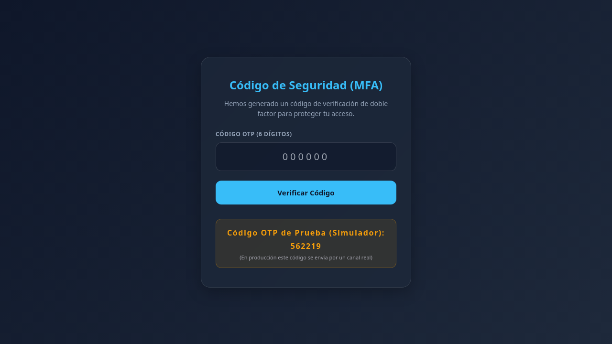

# Manual de Usuario del Sistema Municipal

Este manual documenta el funcionamiento y los flujos operativos de la plataforma.

---

## 1. Acceso e Ingreso al Sistema

Para ingresar a la plataforma, abre tu navegador y dirígete a la URL del sistema.

### Pantalla de Inicio de Sesión
Ingresa tu correo electrónico institucional y contraseña.

> [!IMPORTANT]
> El sistema exige un código de autenticación de doble factor (MFA) que será enviado a tu correo institucional tras introducir tus credenciales.

---

## 2. Panel de Control (Dashboard)

Una vez autenticado, accederás al Dashboard principal del sistema.

Aquí podrás ver:
* Indicadores clave de rendimiento.
* Resumen de actividades recientes.
* Accesos directos a tus módulos de trabajo asignados.

---

## 3. Administración de Usuarios

El módulo de usuarios permite al rol administrador dar de alta, editar y asignar roles a los funcionarios municipales.

